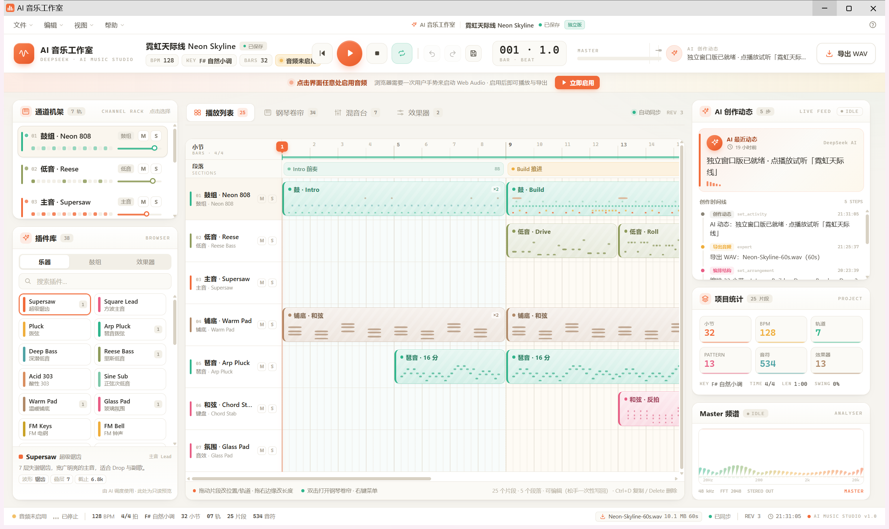

# AI 音乐工作室 · AI Music Studio

一个 **Windows 桌面音乐工作站**（FL Studio 风格的浅色 DAW）。可以像普通 DAW 一样手动编曲，也可以让 AI Agent 通过工具自动建轨、写旋律、编排、混音和导出。

> **这是一个早期原型，不是成熟商业软件。** 仍有很多 bug、未完成的功能，作者不承诺维护和支持；请自行备份工程，使用风险自负。  
> 本项目与 Image-Line / FL Studio 没有任何关联。

[](docs/images/main-window.png)

## 这是什么

- 一个本地运行的桌面 DAW：播放列表、通道机架、钢琴卷帘、混音台、自动化曲线、效果器链、音频片段、键盘演奏/录制。
- 一个 **DeepSeek Harness 插件**：在 DeepSeek Harness 中安装后，AI 可以调用 110+ 个 `studio_*` 工具来创作和修改工程。
- 使用 **GeneralUser GS** 真实采样音色库（32 个采样乐器 + 4 套采样鼓机 + 15 个内置效果器）。
- 支持 **外部 VST3 插件**（Windows x64）：乐器、效果器、参数、预设、参数自动化、冻结/导出。
- 所有工程、音频和导出都保存在本机，不需要登录、不上传工程。

## 这不是什么

- **不是在线 AI 音乐生成服务**：仓库不包含 AI 模型，也不会把提示词变成音频。AI 只是通过工具操作本机 DAW。
- **不是完整商业 DAW**：没有插件原生界面、没有 macOS、没有 VST2/32 位、没有云同步。
- **AI 听不见声音**：所有“混音建议/质量分析”都是本地指标算法（LUFS、频谱、峰值、RMS 等），不是人的听觉判断。
- 不包含第三方商业插件、商业歌曲或音色库；VST3 插件需要你自己安装并遵守其许可。

## 功能

| 模块 | 能力 |
|---|---|
| 编曲 | 多轨、pattern/clip 播放列表、段落、复制、拖拽、裁剪 |
| 钢琴卷帘 | 画/拖/删音符、力度、量化、人性化、和弦、琶音、MIDI 导入导出 |
| 音色 | 32 个 GeneralUser GS 采样乐器、4 套采样鼓机、8 个内置合成器音色 |
| 混音 | 音量/声像/静音/独奏、发送、返回总线 FX、侧链压缩、分轨导出 |
| 自动化 | 音量、声像、滤波、表情、CC、插件参数曲线 |
| 效果器 | 15 种内置效果器 + 外部 VST3 |
| 音频 | 导入 WAV/MP3/FLAC/OGG、录音、片段增益/淡变/反向/拉伸/变调、分割 |
| AI | 110+ 个 `studio_*` 工具：生成 beat/声部/变体、混音建议、质量报告、快速反馈 |
| 导出 | WAV/MP3/FLAC/MIDI/分轨 |

## 普通用户：安装使用

1. 打开仓库右侧 **Releases**，下载 `AI音乐工作室-Setup-2.4.0.exe`。
2. 双击安装（用户级安装，不需要管理员权限），完成后打开桌面的「AI 音乐工作室」。
3. 首次打开点击界面上的「立即启用」或播放按钮解锁音频。
4. 直接播放演示工程，或 `文件 → 新建工程` 手动编曲。
5. 保存/导出在 `文件` 菜单；工程数据默认在 `%APPDATA%\AI音乐工作室\data`。

安装包未做代码签名，Windows SmartScreen 可能提示「仍要运行」。

## AI 功能：需要 DeepSeek Harness

本仓库同时是 **DeepSeek Harness (DSH) 插件**。只安装桌面 exe 时，你可以手动做音乐，但 **AI 不会自己出现**；要使用 AI 创作，需要：

1. 安装 [DeepSeek Harness](https://github.com/deepseek-ai)（以其官方文档为准）。
2. 在本仓库目录运行：

   ```powershell
   node scripts/install.mjs --dry-run   # 先看会改什么
   node scripts/install.mjs            # 安装到 DSH desktop profile
   ```

   如果 DSH 不在默认路径，先设置 `DSH_EXE` 和可选的 `DSH_CLI`、`DSH_HOME`。

3. 在 DSH 对话里让 AI 使用 `studio_*` 工具。常用入口：
   - `studio_app_info`：确认窗口、工程和合法音色 id；
   - `studio_generate_beat`：一键生成鼓/贝斯/和弦/主音；
   - `studio_quick_mix_check`：改完参数后秒级检查峰/削波/低频；
   - `studio_render_preview`：导出前的完整质量预览；
   - `studio_export`：导出成品。

> AI 工具会读写本机工程；对话内容是否上传取决于你使用的 DSH/模型服务，与本项目无关。

## 外部 VST3

- 仅 **Windows x64**，仅 **VST3**。
- 在插件管理器扫描/导入 `.vst3`；托管副本在 `data/plugins`。
- 外部乐器/效果器运行在独立 Node sidecar 中；崩溃不会直接拖垮主程序。
- 首版没有插件原生 GUI，只有通用参数面板、预设、参数自动化。
- VST3 是外部代码，加载前请确认来源和许可；作者不对第三方插件负责。

## 从源码构建

要求：**Windows 10/11 x64**、**Node.js 24**、npm。

```powershell
npm install
npm run build
npm test
```

桌面开发/打包：

```powershell
cd desktop
npm install
$env:ELECTRON_MIRROR = 'https://npmmirror.com/mirrors/electron/'
node node_modules/electron/install.js
npx electron main.cjs
```

构建便携版 exe：

```powershell
node desktop/build-exe.mjs
# 产物：dist/AI音乐工作室-win32-x64/AI音乐工作室.exe
```

更完整的构建、VST3 sidecar 依赖和安装包步骤见 [docs/BUILDING.md](docs/BUILDING.md)。

## 已知问题 / 限制

- 早期原型，功能多但稳定性一般；务必保存/备份工程。
- 仅 Windows x64；不支持 macOS、VST2、32 位插件。
- 外部 VST3 无原生编辑器 GUI；需要插件的图形界面时无法操作。
- AI 没有真实听觉；混音指标是算法近似，最终仍需人耳判断。
- 导出/长工程预览可能较慢；v2.4 增加快速 draft 检查和缓存。
- 安装包未签名；首次运行 SmartScreen 提示。
- 没有自动更新、云同步、账号系统。
- 第三方插件崩溃/卡死由插件自身负责；sidecar 只能隔离到一定程度。

## 文档

- [用户手册](docs/USER-MANUAL.md)
- [架构说明](docs/ARCHITECTURE.md)
- [从源码构建](docs/BUILDING.md)
- [AI 混音反馈工作流](docs/AI-MIX-FEEDBACK.md)
- [AI 作曲指南（需 DSH）](docs/AI-COMPOSER-GUIDE.md)
- [VST3 原生 GUI 方案（未实现）](docs/VST3-NATIVE-GUI-PLAN.md)
- [FAQ](docs/FAQ.md) · [隐私](docs/PRIVACY.md) · [第三方许可](docs/THIRD-PARTY-LICENSES.md) · [AI 内容政策](docs/AI-CONTENT-POLICY.md)

## 目录结构

```
src/client/       React UI + Web Audio 引擎
src/host/         本地 HTTP 服务 / 工程状态 / AI 工具
src/shared/       数据模型、目录、乐理/分析
src/standalone/   独立窗口页面
desktop/          Electron 主进程 / VST3 sidecar / 打包与安装器
assets/           采样音色库、鼓采样与许可证
docs/             用户/架构/构建/许可文档
test/             单元测试
```

## 许可证与致谢

- 本项目原创代码：[MIT](LICENSE)
- 音色：GeneralUser GS（单独的 GeneralUser GS License v2.0，随 assets 分发）
- 鼓采样：Sonic Pi 采样库，CC0
- 第三方依赖：Electron/React/nvst3-host/libflacjs（MIT）、lamejs（LGPL-3.0）、7-Zip SFX（LGPL）等，详见 [THIRD-PARTY-NOTICES.md](THIRD-PARTY-NOTICES.md) 与 [docs/THIRD-PARTY-LICENSES.md](docs/THIRD-PARTY-LICENSES.md)。
- 本项目不是 FL Studio/Image-Line 的官方或关联项目。

## 支持

这是一个个人原型项目，**不提供商业支持，也不保证及时修 bug**。欢迎 issue/PR，但请先阅读 [CONTRIBUTING.md](CONTRIBUTING.md)；涉及安全问题时请按 [SECURITY.md](SECURITY.md) 私下报告。
